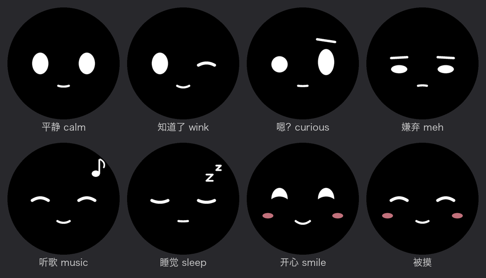

# 桌面小伙伴

一块巴掌大的圆屏，上面有一张会动的脸。可以带在身边：放在桌上、店里吧台，出门揣兜里也行。和你聊天的那个 Claude 能通过它换表情、在屏幕上留一句话、开口说话、帮你开专注、定闹钟叫你起床。



> 这是一个人做给自己用的项目整理出来的通用版。脸是通用的，人设留空，你可以按自己的 AI 伙伴来改。
>
> **仅限个人、非商业使用。** 可以自己做、自己改、自己用，也可以分享给朋友；**不可以修改后用于商业用途**（包括售卖成品、代做代烧、拿去做付费服务）。想商用或定制，请联系作者。详见[许可](#许可)。

---

## 它能做什么

**自己就会的（不联网也行）**
- 会眨眼、东张西望，平静久了自己挤个眼、挑个眉
- 点一下换表情；手指在屏幕上滑 = 摸它，它会眯眼脸红
- 捂住屏幕会闭眼"唔"一声，松手说"找到你了"
- 拿起来会醒，使劲摇会嫌弃你，扣在桌上就睡觉
- 双击开始 25 分钟专注：外圈一圈点，一颗点一分钟，到点"叮"
- 计时提醒（最多 4 个）、闹钟（最多 3 个，存在板子里，断电不丢）
- 到点提醒睡觉，半夜还在玩会再催
- 用电池时 20 秒没动静就关屏浅睡，5 分钟后深睡（关麦克风）

**联网以后**
- claude.ai（网页 / 手机 App）里的 Claude 可以用它：换表情、留字幕、开口说话、开专注、定闹钟、查电量
- 每天定时问候（早安带天气）
- iPhone 来电、微信消息会在屏幕上提醒（只显示是谁，不显示内容）
- 用手机蓝牙给它配 WiFi

**在家 / 店里，Mac 开着时**
- 喊它的名字直接对它说话，它用表情和字幕回你（需要的话也能开口）
- 两种名字：公共名字只出字幕、说话得体（旁边有人时用）；私人名字放松聊天
- "15 分钟后提醒我看面团""明早七点叫我起床""专注 40 分钟""记一下……"直接生效
- 可以录声纹，只理你一个人
- Mac 上放歌时它会跟着听

---

## 需要准备什么

| 东西 | 说明 |
|---|---|
| 板子 | **Waveshare ESP32-S3-Touch-AMOLED-1.75C**（1.75 寸圆形 AMOLED，自带麦克风、喇叭、陀螺仪、电池接口）。别的板子要改引脚和驱动 |
| 锂电池 | 板子背面有电池接口（可选，不接就一直插着 USB 用） |
| Mac | 烧录固件、跑对话桥。对话桥目前只写了 macOS 版 |
| Claude 账号 | claude.ai 里添加"自定义连接器"；对话桥用的是 Claude Code（`claude` 命令），要登录同一个账号 |
| Cloudflare 账号 | 云端中转，免费额度够用。最好有一个自己的域名（国内 workers.dev 常连不上） |
| ElevenLabs（可选） | 想让它开口说话才需要 |

三块是分开的，可以只用一部分：
- **只烧固件**：一个会动、会计时、会叫你起床的小桌宠
- **固件 + 云端**：claude.ai 里的 Claude 能用它
- **固件 + 对话桥**：在 Mac 旁边能对它说话
- **全部**：都有

---

## 一、烧固件

1. 装 [arduino-cli](https://arduino.github.io/arduino-cli/) 和 ESP32 支持包（3.1.x）：
   ```bash
   brew install arduino-cli universal-ctags
   arduino-cli core install esp32:esp32@3.1.0 --additional-urls https://espressif.github.io/arduino-esp32/package_esp32_index.json
   ```
2. 装这几个库：
   ```bash
   arduino-cli lib install "GFX Library for Arduino" U8g2 SensorLib XPowersLib WebSockets NimBLE-Arduino
   ```
3. 复制 `firmware/config.example.h` 为 `firmware/config.h`，填上你的名字、WiFi、时区（不填也能编译，只是不联网）
4. 板子用 USB 插上 Mac，运行：
   ```bash
   ./tools/flash.sh
   ```
   看到 `flashed` 就好了。

**想要专属的脸或叫醒声音？** 这个版本是通用脸，闹钟用提示音。专属表情（按 TA 的形象设计）、用 TA 的声音叫你起床，可以联系作者定制。

---

## 二、云端中转（让 claude.ai 能用它）

1. 改 `cloud/wrangler.toml`：域名、时区、天气城市
2. 部署并设密钥：
   ```bash
   cd cloud
   npm install
   npx wrangler login
   npx wrangler secret put MCP_TOKEN        # 随便一串长的随机字符，等于连接器的钥匙
   npx wrangler secret put BOARD_TOKEN      # 另一串随机字符，和 firmware/config.h 里一样
   npx wrangler secret put ELEVENLABS_API_KEY   # 可选
   npx wrangler deploy
   ```
   随机字符可以用 `openssl rand -hex 24` 生成。
3. claude.ai → 设置 → 连接器 → 添加自定义连接器，网址填：
   ```
   https://你的域名/mcp/你的MCP_TOKEN
   ```
   **这个网址就是钥匙，不要发给别人。**
4. 想让 Claude 主动用它，可以在 claude.ai 的"个人偏好"里加一段，参考 [docs/claude-preference.md](docs/claude-preference.md)

---

## 三、对话桥（在 Mac 旁边对它说话）

```bash
cp -r bridge ~/desk-companion-bridge     # 放到"文稿"外面，后台服务才读得到
cd ~/desk-companion-bridge
./setup.sh                               # 装 whisper、Python 依赖、下载模型
```
然后：
1. 打开 `config.env`，填 `BOARD_TOKEN`、你的名字、叫它的名字
2. 写 `persona/CLAUDE.md`：它是谁、你是谁、你们怎么相处（这就是它的性格）
3. 终端里先跑 `claude` 登录一次
4. 试一下：`python3 bridge.py`，对板子喊名字说句话
5. 没问题了，设成开机自动启动：`./install_launchd.sh`

**录声纹（可选）：** `python3 enroll.py`，按屏幕提示说 8 句话。之后它只理你的声音。声纹只存在你的 Mac 上。

**隐私：** 板子只在听到有人说话时才录一整句，发给你自己 Mac 上的 whisper 转文字（不联网）。没叫名字的话转完就丢，不记录。

---

## 给它配 WiFi

三种方法：
- 写在 `firmware/config.h` 里（烧录时带进去）
- 插着 USB：`python3 tools/add_wifi.py`（密码输入时不显示）
- 用手机：App Store 装 **LightBlue**，连上板子（iPhone 会弹配对），找到"WiFi设置"那一项，写入 `WiFi名字|密码`

只支持 2.4GHz。用 iPhone 热点要打开"最大兼容性"。最多记 6 个，会自动选：优先能找到 Mac 的那个网络。

---

## 串口命令（调试用）

`python3 tools/send.py "命令"`：

| 命令 | 作用 |
|---|---|
| `0`–`6` | 换表情（calm / wink / curious / meh / music / sleep / smile） |
| `S你好` | 显示一句字幕 |
| `P` | 看电量、网络、内存 |
| `M25` / `M0` | 开始 25 分钟专注 / 结束 |
| `W600\|看面团` / `W0` | 10 分钟后提醒 / 全部取消 |
| `L7:30\|62` / `L0` | 工作日 7:30 闹钟（62 = 周一到周五，127 = 每天，128 = 只响一次）/ 全部取消 |
| `N名字\|密码` / `Nlist` / `Ndel:名字` | 加 / 看 / 删 WiFi |
| `B` | 假装用电池（插着线测睡眠） |

---

## 还不完善的地方

- **续航**：还在测。开着 WiFi 和麦克风、屏幕常亮时，一块小电池撑不过一两天；现在加了两层睡眠，实际数据还没测完
- **对话桥只支持 Mac**，Windows / Linux 要自己改（主要是 launchd 和找 Mac 的那部分）
- **只认中文语音**（whisper 设的是中文），英文名字靠开头再识别一次
- 空闲内存大约 70KB（蓝牙占了不少），再加大功能要留意
- 金属外壳会挡一点 WiFi 信号

## 踩过的坑（省你的时间）

- Apple 芯片的 Mac 没装 Rosetta 时，arduino 自带的 ctags 跑不了：代码都写在 `.cpp` 里，`.ino` 只留一行注释，用 Homebrew 的 ctags
- 烧录脚本里不要用 `grep -q` 判断成功：它提前退出会把烧录掐断
- 触摸芯片 CST9217 不能一直轮询，会卡死：只在中断后读，连续读不到就复位
- 串口日志没人读时会卡住主循环：日志都走 `logf()`，先看缓冲区有没有空位
- whisper 的提示词里别放名字：听不清时它会把提示词吐出来，等于替你叫了名字
- macOS 后台服务（launchd）读不了"文稿 / 桌面 / 下载"里的文件
- 板子的中文字库没有 é 之类带重音的字母，云端发字幕前会换掉

---

## 许可

- **本项目自己写的代码**：[PolyForm Noncommercial 1.0.0](LICENSE)
  - ✅ 可以：个人学习、自己做一个用、修改、分享给朋友、非营利用途
  - ❌ 不可以：修改或不修改后用于任何商业用途——卖成品 / 套件、收费代做代烧、做成付费产品或服务
  - 想商用、想要定制（专属的脸、声音、人设），请联系作者
  - 转发或分享时请保留 LICENSE 文件和作者署名
- **第三方文件保留原许可**：`firmware/es7210.*`、`es8311.*`、`audio_hal.h` 来自乐鑫（Espressif）的驱动；`firmware/pin_config.h` 来自 Waveshare 官方示例（Apache 2.0，见 [docs/LICENSE-waveshare-apache2.txt](docs/LICENSE-waveshare-apache2.txt)）
- 用到的库（各自的许可）：Arduino_GFX、U8g2（Unifont 中文字体）、SensorLib、XPowersLib、arduinoWebSockets、NimBLE-Arduino、whisper.cpp、sherpa-onnx

> 说明：带"非商用"限制后，这个项目严格来说是"源码公开"，不是 OSI 定义的"开源"。
